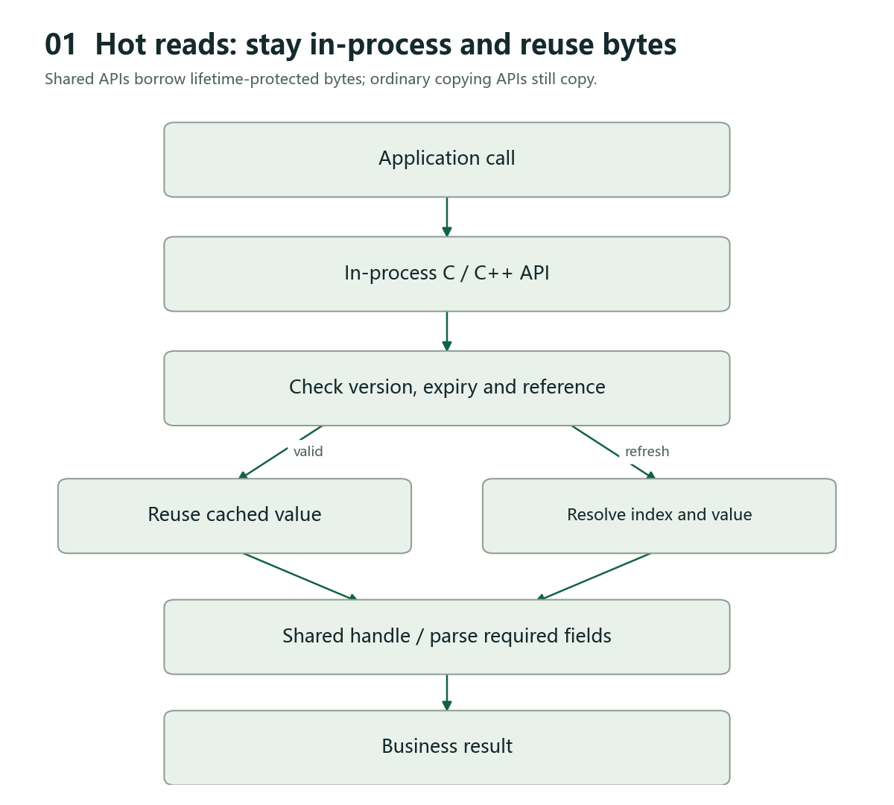
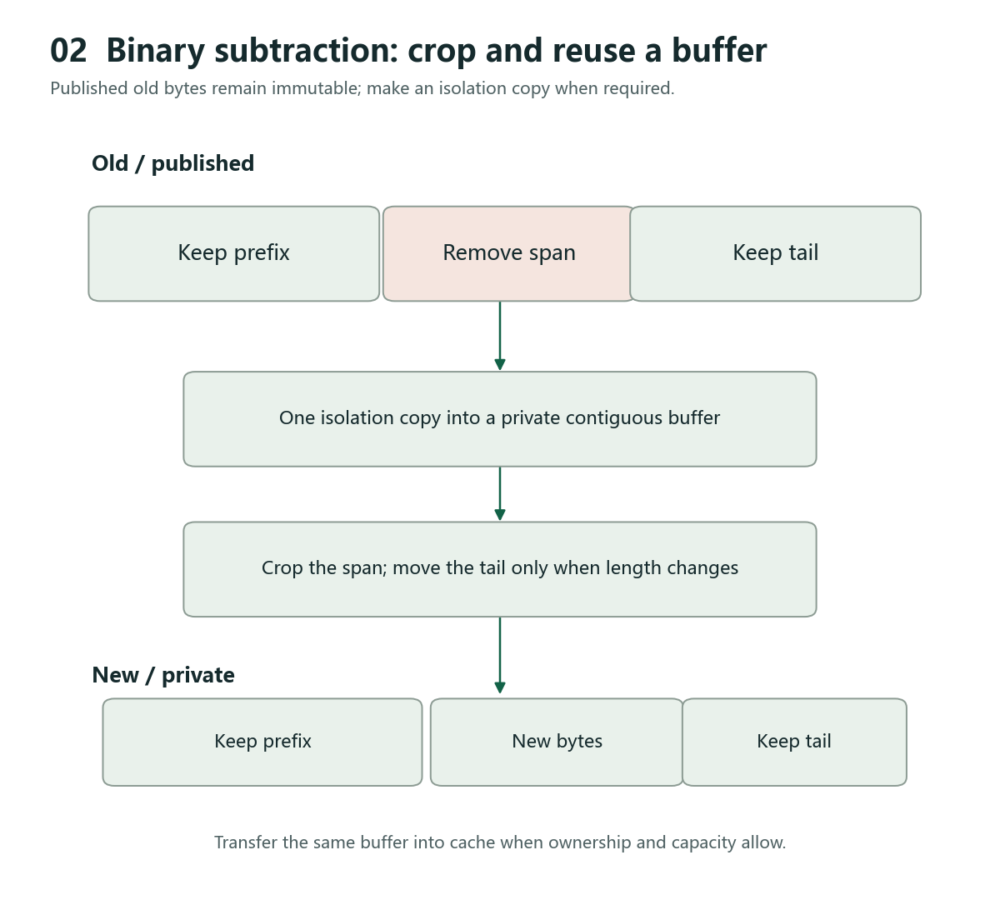
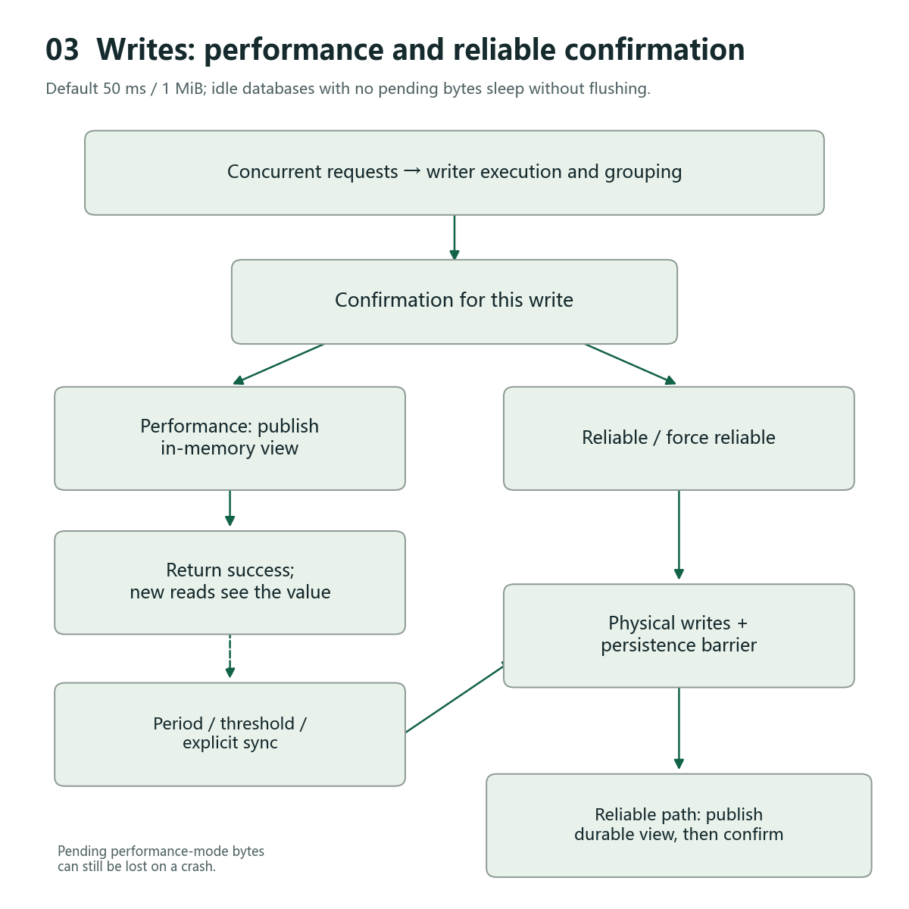

# FengquDB

**[English](README.md) | [简体中文](README.zh-CN.md)**

- **Read throughput is ~400× that of MySQL**: single-thread complete-profile reads measured at **442.74×**.
- **Single-record insert throughput is ~40× that of MySQL**: single-thread inserts measured at **44.03×**.
- **Just 1.08 MiB for the native core**: approximately **1/46** of the MySQL Windows server executable.

Throughput figures use the 128 B profile-body business benchmark in performance mode. Size uses the Windows x64 LTO validation DLL versus MySQL `mysqld.exe` (49.25 MiB), excluding other tools and dependencies on both sides. Charts retain the earlier benchmark results. [Test settings](#benchmarks) · [Size evidence](docs/SIZE_COMPARISON.md)

### Goal: the world's fastest database

**A native C++ database in a 1.08 MiB core, built to be the storage foundation for the AI era.** Embed it in your application for fast local persistence, from game saves and application state to the data behind agents, retrieval, RAG and knowledge systems.

[Quick start](#quick-start) · [Benchmarks](#benchmarks) · [API guides](#language-sdks) · [Apache-2.0](LICENSE)

## Why FengquDB

- **Fast where applications spend their time.** In our published performance-mode benchmark, FengquDB led confirmed throughput in all **44 tested configurations**, reaching **3.32 million complete-profile reads/second with one calling thread**.
- **A tiny native core.** The Windows x64 LTO validation DLL is **1.08 MiB** (1,128,960 bytes). SDK tools and language bindings are additional; platform binaries differ in size.
- **Embed a library and keep control.** No separate database service. Set your storage directory, share a handle across your application, and create separate databases when needed.
- **Binary data with less work.** A purpose-built C++ storage engine, Protobuf-compatible wire encoding, shared reads, incremental updates and cached-binary subtraction avoid unnecessary copies and reconstruction.
- **Choose the confirmation your data needs.** Performance mode makes writes visible in memory before periodic persistence. Reliable mode, or `force_reliable` on an individual write, waits for persistence before success.
- **Ready for real application state.** Atomic operations and batches, transactions, TTL, indexes, conditional queries, sorting, aggregation, backup and recovery. [Explore the APIs](#language-sdks).

“World's fastest” describes our ambition. The results below measure the listed workloads and settings; they do not establish a universal database ranking.

## Quick start

SDKs come as separate ZIPs for each language and development platform, distributed as repository release assets when published. Once you have the **Python SDK for your platform**, unzip it and copy its `FengquDB` folder beside `main.py`:

```text
my-app/
  main.py
  FengquDB/
```

```python
from pathlib import Path
from FengquDB import Store

Path("save").mkdir(exist_ok=True)
with Store("save/main") as db:
    db.put(b"name", b"Alice")
    db.put(b"score", (95).to_bytes(8, "little", signed=True))
    print(db.get(b"name").decode(),
          int.from_bytes(db.get(b"score"), "little", signed=True))
    db.sync()
```

```sh
python main.py
# Alice 95
```

Strings and integers can be encoded to bytes and stored without defining an entity. For application entities, define your class and use the SDK's automatic codec generation; the manual generation tool is included as a fallback. [Entity example](docs/languages/python.md).

A [complete runnable example](examples/quickstart/main.py) also updates a score with reliable persistence, closes and reopens the database, then deletes the example records. Expected output:

```text
Alice 95
Reopened score: 96
Deleted: None
```

Open a database once at application startup, reuse its handle, and close it on shutdown. Unity uses a shared application entry point and `Application.persistentDataPath`; see its dedicated guide.

## Benchmarks

**Single-thread results first.** These charts compare the same ten-field profile business using each database's usual development model: Protobuf wire for FengquDB, typed SQL columns for MySQL/SQLite, Hash and native atomic operations for Redis, and SQL plus JSON cache-aside for MySQL+Redis.

The charts show **confirmed business operations/second**, using the median of three runs. Every axis starts at zero and uses a real linear scale. Under **each operation**, the four multipliers mean **FengquDB throughput ÷ comparator throughput**; for example, **4.60×** means 4.60 times the throughput. A batch read counts as one call that returns 32 profiles.

**Durability matters:** FengquDB uses performance mode (**50 ms / 1 MiB**, memory acknowledgement); MySQL uses `flush=2`; Redis uses AOF `everysec`; SQLite uses WAL `NORMAL`. These are different durability windows, not per-operation reliable-commit comparisons. Embedded calls and local TCP service calls also have different overhead. The entire gap cannot be attributed to serialization.

### Single thread · 128 B profile body

Read → insert → delete → small-field update → complete save, followed by mixed access, batch reads, projection, counters and transactions.


<details>
<summary><strong>Single thread · 4 KiB profile body — all 11 operations</strong></summary>


</details>

<details>
<summary><strong>8 calling threads · 128 B profile body — all 11 operations</strong></summary>


</details>

<details>
<summary><strong>8 calling threads · 4 KiB profile body — all 11 operations</strong></summary>


</details>

Across these 44 configurations, confirmed throughput was **1.36–4.94× the strongest comparator in each configuration**. This does not mean every latency percentile or durability setting wins.

**Environment:** AMD Ryzen 9 9950X3D host; Docker/WSL2 Linux; client and service together limited to 2 logical CPUs and 4 GiB RAM, no swap. 660 samples, 11 workloads, 2 profile-body sizes, 1/8 calling threads, 5 databases, 3 rounds. Each sample passed complete-field checks and a reopen check from a separate client process. This is a warm, short-duration application benchmark, not a power-loss or out-of-memory endurance test.

[Full report and methodology](docs/benchmarks/README.md) · [CSV](docs/benchmarks/results.csv) · [All ratios](docs/assets/benchmarks/comparisons.json) · [Raw evidence](docs/benchmarks/raw-evidence.zip) · [Reproduction inputs](docs/benchmarks/reproduction-inputs.zip)

## Why it is fast: the designs in the code

The core idea is to **remove a layer, avoid a copy, reuse a buffer and do work only for what changed**. These mechanisms work together. The measured end-to-end gap is not an independently measured speedup for every individual technique.

### 1. Keep hot reads inside the process and the binary



A balance read can use a supported shared API to borrow lifetime-protected bytes and parse the required fields; ordinary copying APIs still copy. Version, expiry and reference checks control reuse. Embedding also removes the local TCP round trip used by the MySQL/Redis clients in this benchmark.

### 2. Subtract and patch instead of repeatedly rebuilding



This is **cached-binary subtraction**: repeated edits reuse a private buffer instead of repeatedly concatenating many reusable fragments. Existing snapshots and shared readers retain their immutable old bytes. A cold reconstruction of a deletion can also skip the removed raw extent.

For a complete 4 KiB profile save that changes a few fields, **automatic multi-range deltas** can use an already-cached equal-length base, compare blocks and record a few changed spans. Current automatic candidates are 1–64 KiB with at most 8 ranges. Dense changes, a cold base or the depth bound cause a full-write fallback; the engine does not perform an extra cold read just to search for a delta. This reduces copying and log bytes for suitable updates, not every possible save.

### 3. Centralize write execution and share persistence work



Performance mode defaults to **50 ms / 1 MiB**, so multiple writes can share persistence costs. An idle database with no pending writes sleeps and does not flush. A bounded adaptive wait reduces repeated sleep/wake transitions during continuous traffic. Reliable writes retain a persistence barrier. A crash can still lose acknowledged performance-mode data that has not reached durable storage.

### 4. More source-verified optimizations

| Design | Work it avoids | Implementation |
| --- | --- | --- |
| Bounded Protobuf wire and generated codecs | Generated entity code reduces textual field-name and reflection work; Protobuf is an encoding, not a general-purpose compressor | [Wire](include/fengqudb_wire.hpp), [code generator](tools/codegen/) |
| Read stamps and weak read memos | Valid metadata and existing values can be reused without reacquiring a full view; the memo does not pin a complete value indefinitely | [Read fast paths](src/store.cpp) |
| Reused and incremental CRCs | Reuses known checksums; suitable small patches derive the new CRC from the old CRC and changed bytes, with a fallback when that costs more | [CRC delta](src/crc_delta.hpp), [WAL reads](src/paged/wal.hpp) |
| Conditional buffer ownership transfer | A uniquely owned, suitably sized private buffer can enter the read cache without another payload copy; shared aliases stay isolated | [Private buffers](src/paged/budget.hpp) |
| Different physical paths for small and large writes | Small groups reuse reserved cells; large groups append and let large payloads bypass the small staging buffer | [Hybrid file](src/paged/hybrid_file.hpp), [cell reservation](src/paged/cell_file.hpp) |
| Budgeted, demand-driven headroom | Uses recent activity and pending bytes to reduce repeated growth; no separate 1 MiB reservation per record | [Reserve pool](src/paged/reserve_pool.hpp) |
| Writer-executed atomic operations | Suitable read/compute/update work executes on the write side, reducing producer competition and recomputation; general transactions still validate conflicts | [Atomic operations](src/paged/operations.hpp), [commit grouping](src/paged/group.hpp) |
| Reused index rules and query plans | Valid version conditions avoid re-reading and parsing the catalog; indexes narrow candidates before C++ filtering | [Query execution](src/paged/select_execute.hpp), [planning](src/paged/select_plan.hpp) |
| A bounded heap for Top N | Retains a bounded set of candidates for the requested page rather than fully sorting and transferring all matches; poor predicates may still scan many candidates | [Sort execution](src/paged/select_execute.hpp) |
| Batched maintenance with budgets | Copies live data in maintenance work bounded by I/O quotas, deadlines and cancellation | [Copying](src/paged/copy.hpp), [maintenance budgets](src/paged/maintenance.hpp) |
| A small runtime and release build | No full Google Protobuf runtime in the core; generation tools, diagnostics adapters and bindings are separate, with unused-code elimination at link time | [Build configuration](CMakeLists.txt) |

Reserved cells use additional disk space; separate small/large paths also avoid imposing the same cell write amplification on large payloads.

Locks, allocations, cold reads and disk costs still exist. Gains depend on changed bytes, cache hits and access patterns. Performance-mode acknowledgement is also part of the measured advantage.

## Language SDKs

One independent SDK folder per language, with binaries, generation tools and two guides. Native release targets include Windows, Linux, Android and iOS; Unity SDKs include both macOS architectures. Select the SDK for your development host.

| Language | Get started | API, use cases and examples |
| --- | --- | --- |
| C++ | [Guide](docs/languages/cpp.md) | [API](docs/api/cpp.md) |
| C# | [Guide](docs/languages/csharp.md) | [API](docs/api/csharp.md) |
| Unity | [Guide](docs/languages/unity.md) | [API](docs/api/unity.md) |
| Python | [Guide](docs/languages/python.md) | [API](docs/api/python.md) |
| Java | [Guide](docs/languages/java.md) | [API](docs/api/java.md) |
| Node.js / TypeScript | [Guide](docs/languages/node.md) | [API](docs/api/node.md) |
| Go | [Guide](docs/languages/go.md) | [API](docs/api/go.md) |
| Rust | [Guide](docs/languages/rust.md) | [API](docs/api/rust.md) |
| C | [Guide](docs/languages/c.md) | [API](docs/api/c.md) |

Unity: copy the SDK's `FengquDB` folder into `Assets/Plugins`, preserving `.meta` files. The package includes the target-specific native libraries and generation tools. [Apple build verification](docs/APPLE_SDK.md).

## Where it fits

Use FengquDB for **in-process server state, desktop applications, Unity game saves, local-first software and the persistent data behind AI agents, retrieval, RAG and Wiki layers**. The database stores data; an embedding model is not required for ordinary storage.

The core offers structured query APIs rather than a complete SQL language. Network serving, database users/permissions and replication are outside its current scope. Index, RAG and LLM Wiki foundations are separate layers; a core SDK does not include an embedding model or a ready-made RAG application. Apple libraries have passed build/link checks; Unity iOS device acceptance is still pending.

Performance-mode acknowledgement can precede persistence. Use reliable writes for payments, entitlements and other critical state. [Persistence and API examples](docs/api/python.md).

## Contact and support

**Business and personal enquiries:** [txjmybsdy@163.com](mailto:txjmybsdy@163.com)

I specialize in using AI to build novel products and applications. If you have a promising business idea or are looking for a senior technical consultant, please get in touch by email.

I value every opportunity offered by the community and society, and approach each with respect. Collaboration, practical use cases and thoughtful feedback are welcome.

For bug reports, include your platform, binding language, steps to reproduce and redacted logs to help diagnose the issue.

If FengquDB helps your work, you can support its continued development:

| Alipay | WeChat Pay |
| :---: | :---: |
|  |  |

Voluntary contributions support continued project maintenance. Verify the recipient in your payment app before paying.

## License and source attribution

[Apache License 2.0](LICENSE) allows commercial use, modification and redistribution under its terms. Protobuf reference material and any third-party components keep their own notices; see [NOTICE](NOTICE) and [third-party attribution](THIRD_PARTY_NOTICES.md).

For building the database itself, see [Development](docs/DEVELOPMENT.md).
