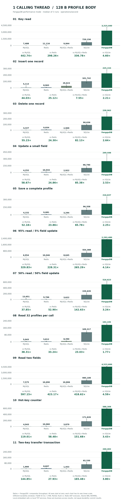
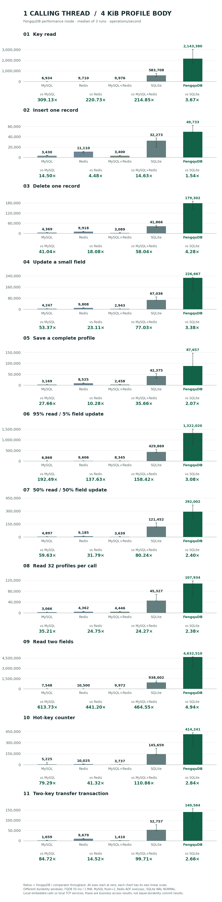
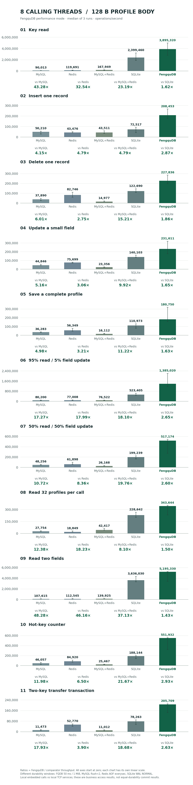
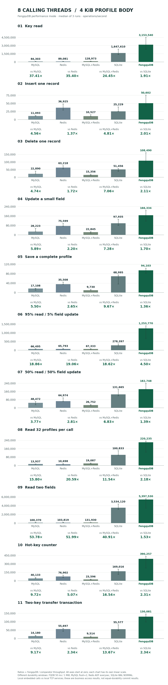
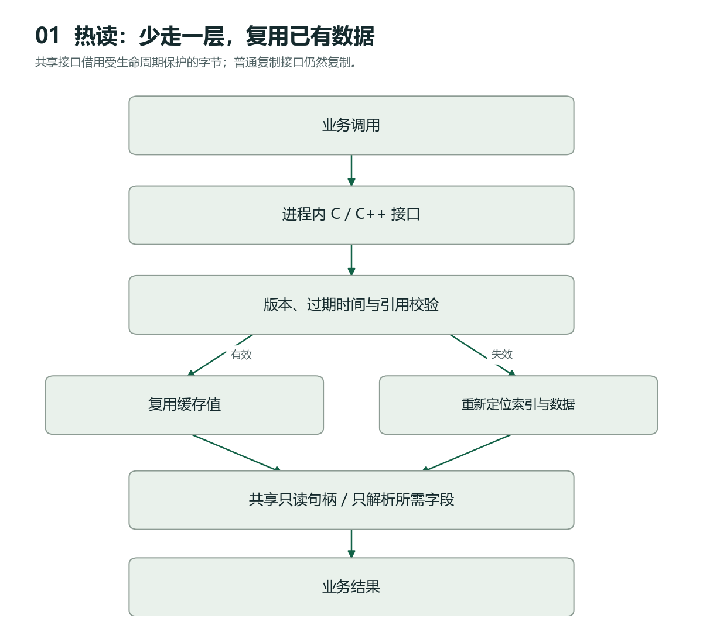
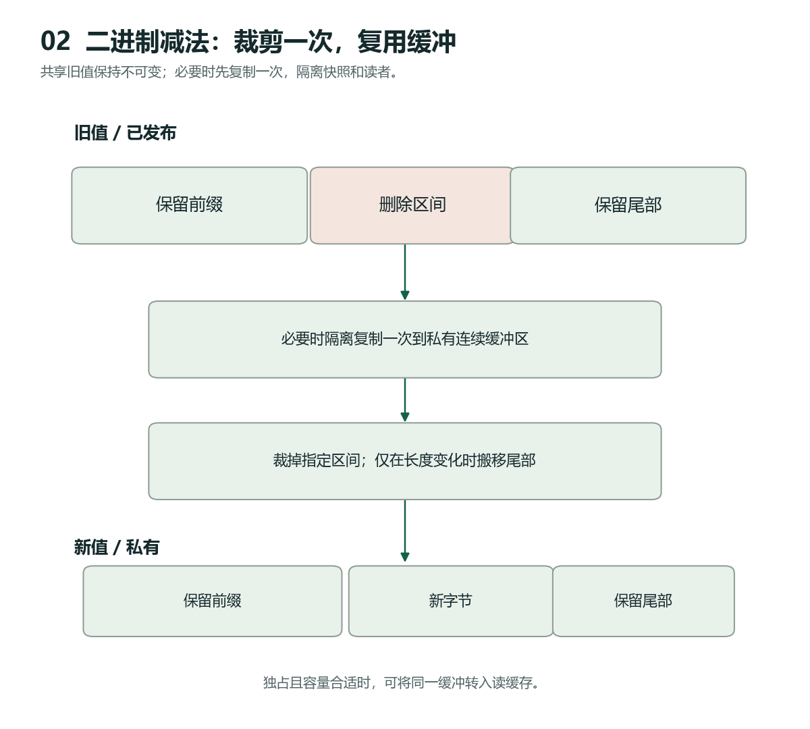
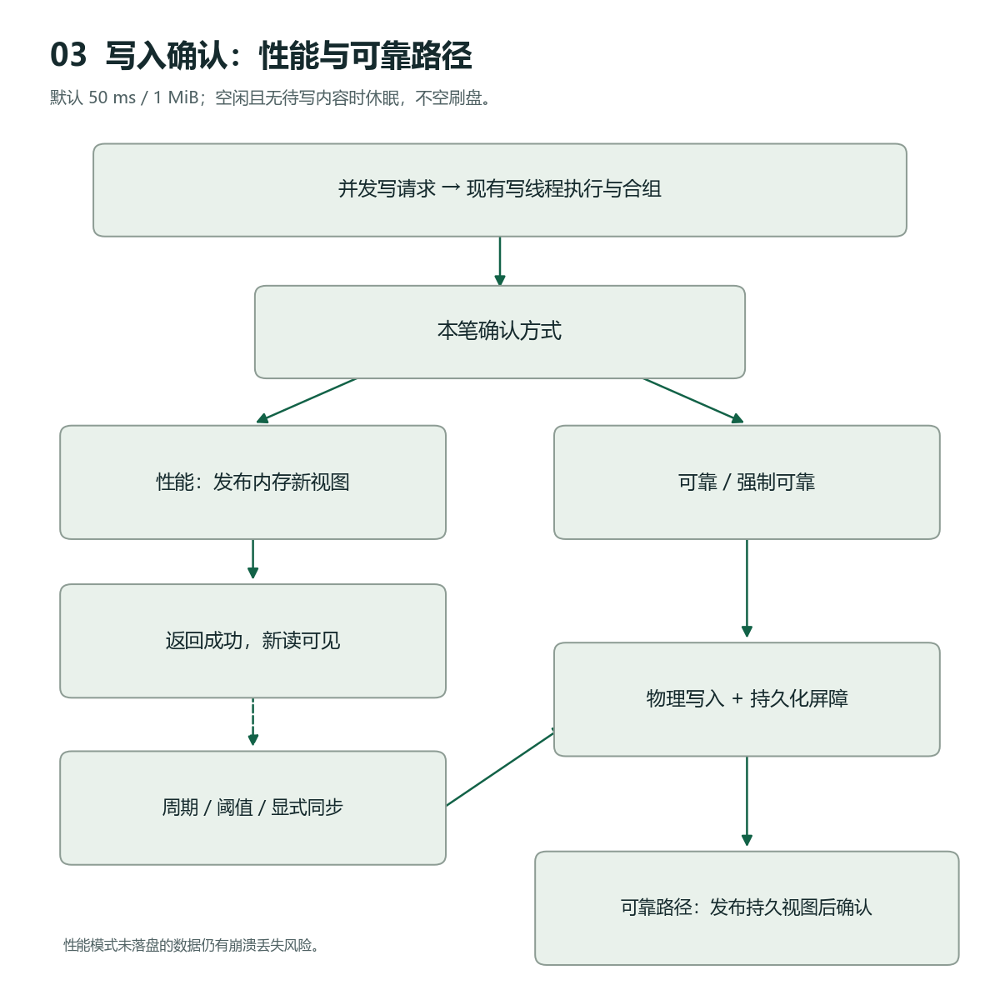

# FengquDB

**[English](README.md) | [简体中文](README.zh-CN.md)**

- **读取速度约为 MySQL 的 400 倍**：单线程完整档案读取吞吐，实测 **442.74×**。
- **单条新增写入速度约为 MySQL 的 40 倍**：单线程新增吞吐，实测 **44.03×**。
- **原生核心仅 1.07 MiB**：约为 MySQL Windows 服务端主程序的 **1/46**。

前两项为 128 B 简介档案的性能模式业务吞吐；体积来自 1.0.0 Windows x64 正式发布包，对比 MySQL `mysqld.exe`（49.25 MiB），不含双方其他工具与依赖。性能图沿用此前实测版本。[测试条件](#性能实测) · [体积来源](docs/SIZE_COMPARISON.md)

### 目标：世界上最快的数据库

**仅 1.07 MiB 的原生 C++ 数据库核心，为 AI 时代的各种解决方案提供高速存储底座。** 从游戏存档、应用状态，到 AI Agent、检索、RAG 和知识系统的数据，直接嵌入项目即可使用。

[快速体验](#快速体验) · [性能实测](#性能实测) · [各语言接入](#各语言接入) · [Apache-2.0](LICENSE)

## 为什么选择 FengquDB

- **把性能用在业务最常走的路径上。** 本次公开的性能模式测试中，**44 组配置的确认吞吐全部领先**，单调用线程按键读取完整档案达到 **332 万次/秒**。
- **原生核心足够小。** Windows x64 正式发布包的 DLL 为 **1.07 MiB**（1,126,912 字节）。生成工具与语言绑定另计，各平台原生库大小不同。
- **一个库文件，嵌进自己的进程。** 无需部署独立数据库服务。存档目录由业务设置，数据库句柄可以共享，需要时建立多个数据库。
- **尽量少复制、少重建、少做重复计算。** 自研 C++ 存储引擎、Protobuf 兼容二进制编码、共享读取、增量更新与缓存二进制减法协同工作。
- **速度和可靠性由业务选择。** 性能模式在内存生效后确认，再按周期或阈值持久化；可靠模式以及单笔 `force_reliable` 写入，等待持久化成功才返回。
- **覆盖真正需要的数据库能力。** 原子操作、批量读写、事务、TTL、索引、条件查询、排序、聚合、备份与恢复。查看[各语言 API](#各语言接入)。

“世界最快”是我们追求的目标。下面给出具体场景与条件下的实测，不把一次测试当成所有数据库、所有负载的世界排名。

## 快速体验

SDK 按语言和开发平台提供独立 ZIP，放在仓库的 Releases 附件中。取得对应平台的 **Python SDK** 后，解压并把 `FengquDB` 文件夹放在 `main.py` 旁边：

```text
my-app/
  main.py
  FengquDB/
```

```python
from pathlib import Path
from FengquDB import Store

Path("save").mkdir(exist_ok=True)
with Store("save/main") as db:
    db.put(b"name", b"Alice")
    db.put(b"score", (95).to_bytes(8, "little", signed=True))
    print(db.get(b"name").decode(),
          int.from_bytes(db.get(b"score"), "little", signed=True))
    db.sync()
```

```sh
python main.py
# Alice 95
```

单个字符串和整数转换为 bytes 即可存储，不必先定义实体。存业务实体时，定义自己的类，由 SDK 自动生成序列化代码；随包也有手动生成工具。[实体接入例子](docs/languages/python.md)。

[完整可运行示例](examples/quickstart/main.py) 还会可靠修改成绩、关闭重开验证，再删除样例记录。预期输出：

```text
Alice 95
Reopened score: 96
Deleted: None
```

实际项目在初始化时打开数据库，各模块复用句柄，退出时关闭。Unity 的统一入口与 `Application.persistentDataPath` 用法见独立接入文档。

## 性能实测

**单线程优先展示。** 五种实现处理同一个十字段档案业务，各用常规开发方式：FengquDB 使用 Protobuf wire，MySQL/SQLite 使用类型列和预编译 SQL，Redis 使用 Hash 与原生原子操作，MySQL+Redis 使用 SQL 加 JSON cache-aside。

图表为 **3 轮确认吞吐的中位数**，单位是业务调用次数/秒；真实线性刻度，从零起算。**每项业务图下**列出对四种方案的倍数，计算为 **FengquDB 吞吐 ÷ 对方吞吐**。例如 **4.60×** 表示吞吐为对方的 4.60 倍。一次读 32 份按一笔业务调用计数。

**持久化设置需要一起看：** FengquDB 为性能模式（**50 ms / 1 MiB，内存确认**）；MySQL 为 `flush=2`；Redis 为 AOF `everysec`；SQLite 为 WAL `NORMAL`。各自丢失窗口不同，这是业务调用方案对比，不是每笔可靠提交对比。内嵌调用与本机 TCP 服务调用也有开销差异，不能把全部差距归功于序列化。

### 单线程 · 128 B 简介

先看查、增、删、小字段修改和完整保存，再看混合读写、批量读取、字段投影、热点计数与事务。



<details>
<summary><strong>单线程 · 4 KiB 简介：展开全部 11 项业务</strong></summary>



</details>

<details>
<summary><strong>8 调用线程 · 128 B 简介：展开全部 11 项业务</strong></summary>



</details>

<details>
<summary><strong>8 调用线程 · 4 KiB 简介：展开全部 11 项业务</strong></summary>



</details>

这 44 组配置中，FengquDB 的确认吞吐为**各组最强对手的 1.36～4.94 倍**。这不表示所有延迟分位数、所有持久化模式也都领先。

**环境：** AMD Ryzen 9 9950X3D 主机，Docker/WSL2 Linux；客户端与服务合计限制 2 逻辑 CPU、4 GiB 内存、关闭 swap。11 项业务 × 2 个简介长度 × 1/8 调用线程 × 5 种实现 × 3 轮，共 660 个样本。每个样本均核对完整字段，并由独立客户端进程重开验证。测试是短时热数据业务测量，不是断电、超内存或长时间耐久测试。

[完整报告与测试方法](docs/benchmarks/README.md) · [原始 CSV](docs/benchmarks/results.csv) · [全部倍数](docs/assets/benchmarks/comparisons.json) · [原始证据](docs/benchmarks/raw-evidence.zip) · [复现输入](docs/benchmarks/reproduction-inputs.zip)

## 为什么它这么快：代码里的设计思路

核心思路是：**少走一层、少复制一次、少重建一份，只为真正变化的数据做工作。** 这些设计协同起作用；下面是源码中的实际机制，不是把整套实测差距拆成未经测量的单项收益。

### 1. 热读尽量留在进程和二进制里



例如读取玩家的余额，支持的共享接口可直接借用受生命周期保护的二进制，只解析需要的字段；普通复制型接口仍会复制。版本、过期时间和数据引用会参与有效性判断，避免读到不该复用的旧值。内嵌架构也省去了本轮 MySQL/Redis 访问中的本机 TCP 往返。

### 2. 减法裁剪与差量，减少整份重建



这就是保留的**缓存二进制减法**：不是把大量可复用的小块反复拼接成新对象。连续修改尽量复用同一份私有缓冲；已有快照和共享读者仍保留自己的不可变旧值。冷读重建删除操作时，也可以跳过已经被删掉的原始区间。

完整保存一份 4 KiB 档案、实际只改了几个字段时，还可以使用**自动多段差量**：只比较已缓存的等长基值，按块检查相同内容，记录少数变化区间。当前自动候选限于 1～64 KiB、最多 8 段，差量过密、基值未缓存或链深达到限制时转为完整写入，不为寻找差量额外冷读。它减少的是特定场景的复制和日志量，不保证任何整存都只写几个字节。

### 3. 写入集中执行，持久化按需要合并



默认性能模式为 **50 ms / 1 MiB**：多次业务写入可以分摊持久化成本，空闲且没有待写内容时休眠，不空刷盘。连续请求时采用有上限的短等候，减少频繁睡眠唤醒。可靠路径保留持久化屏障；性能模式已经确认但尚未持久化的数据，在崩溃时仍可能丢失。

### 4. 其他经源码核对的优化

| 设计 | 实际少做了什么 | 对应实现 |
| --- | --- | --- |
| 自研有限 Protobuf wire 与生成式编解码 | 实体可走生成代码，减少文本字段名与动态反射开销；Protobuf 是编码格式，不是通用压缩算法 | [wire](include/fengqudb_wire.hpp)、[生成器](tools/codegen/) |
| 热读版本戳与弱引用备忘 | 条件有效时复用元数据与已存在的值，少取一次完整视图；不额外长期占住整份数据 | [读取快路径](src/store.cpp) |
| 校验值复用与 CRC 增量计算 | 已知内容不反复完整校验；适合的小修改用旧 CRC 和变化区间计算新 CRC，成本不合算则回退 | [CRC 差量](src/crc_delta.hpp)、[WAL 读取](src/paged/wal.hpp) |
| 有条件的缓冲所有权转移 | 提交后可独占且容量合适的私有缓冲直接转入缓存，省去一次复制；共享引用存在时保持隔离 | [私有缓冲](src/paged/budget.hpp) |
| 小写与大写不同物理路径 | 小批次复用预留单元；大批次走追加路径，并让大块载荷绕过小块拼装缓冲 | [混合文件](src/paged/hybrid_file.hpp)、[单元预留](src/paged/cell_file.hpp) |
| 预算化、按需增长的空间预留 | 按近期活动与待写量准备空间，减少反复扩容；不是每条记录各预留 1 MiB | [预留池](src/paged/reserve_pool.hpp) |
| 常用原子操作交给写入执行者 | 合适的读、计算、修改在写入方执行，减少业务线程之间的竞争和重新计算；通用事务仍校验冲突 | [原子操作](src/paged/operations.hpp)、[提交合组](src/paged/group.hpp) |
| 复用索引规则与查询计划 | 版本条件有效时少读、少解析目录；索引先缩小候选，过滤在 C++ 中完成 | [查询执行](src/paged/select_execute.hpp)、[选择计划](src/paged/select_plan.hpp) |
| Top N 使用有界堆 | 只保留分页所需的有界候选，避免把所有匹配结果完整排序和跨语言传输；差条件仍可能扫描很多数据 | [排序执行](src/paged/select_execute.hpp) |
| 批量整理与维护预算 | 整理集中复制有效数据，并按 I/O 预算、超时和取消条件限制工作，减少不可控维护开销 | [整理复制](src/paged/copy.hpp)、[维护预算](src/paged/maintenance.hpp) |
| 精简运行时与发布构建 | 核心不链接 Google Protobuf 完整运行时；生成工具、诊断适配与语言绑定独立，发布链接移除无用代码 | [构建配置](CMakeLists.txt) |

预留单元会增加磁盘空间；小写、大写分路，也是在避免大载荷承担相同的单元写放大。

这些机制仍有锁、内存分配、冷读和磁盘成本；收益取决于数据变化、缓存命中与访问方式。性能模式的确认语义同样是本轮速度优势的一部分。

## 各语言接入

每个 SDK ZIP 同时包含英文（`GettingStarted.md`、`API.md`）和简体中文（`接入.md`、`API.zh-CN.md`）文档。

每种语言一个独立 SDK 文件夹，包含预编译库、生成工具及中英文接入和 API 文档。桌面 SDK 提供 Windows 和 Linux 包；Unity SDK 还包含 Android、iOS 和 macOS 两种 CPU 架构的原生库。按开发电脑选择对应包。

| 语言 | 快速接入 | API、用途与调用例子 |
| --- | --- | --- |
| C++ | [接入](docs/languages/cpp.md) | [API](docs/api/cpp.md) |
| C# | [接入](docs/languages/csharp.md) | [API](docs/api/csharp.md) |
| Unity | [接入](docs/languages/unity.md) | [API](docs/api/unity.md) |
| Python | [接入](docs/languages/python.md) | [API](docs/api/python.md) |
| Java | [接入](docs/languages/java.md) | [API](docs/api/java.md) |
| Node.js / TypeScript | [接入](docs/languages/node.md) | [API](docs/api/node.md) |
| Go | [接入](docs/languages/go.md) | [API](docs/api/go.md) |
| Rust | [接入](docs/languages/rust.md) | [API](docs/api/rust.md) |
| C | [接入](docs/languages/c.md) | [API](docs/api/c.md) |

Unity：把 SDK 的 `FengquDB` 文件夹复制到 `Assets/Plugins`，保留 `.meta`。各平台原生库和生成工具都已随包提供。[Apple 构建验证](docs/APPLE_SDK.md)。

## 适合做什么

适合**进程内服务器状态、桌面应用、Unity 存档、本地优先软件，以及 AI Agent、检索、RAG、Wiki 上层的数据持久化**。普通数据存储不需要安装向量模型。

核心提供结构化查询 API，尚无完整 SQL 语言；远程服务、数据库用户权限和复制不在当前范围。索引、RAG、LLM Wiki 是独立上层，核心 SDK 本身不包含向量模型或开箱即用的 RAG 应用。Apple 库已完成构建与链接检查，Unity iOS 真机验收仍待完成。

性能模式可能在持久化前就确认成功。付款、权益等关键状态请使用可靠写入。[写入模式与调用例子](docs/api/python.md)。

## 联系与支持

**商务合作与个人沟通：** [txjmybsdy@163.com](mailto:txjmybsdy@163.com)

我擅长运用 AI 技术开发新颖的产品与应用。如果你有好的商业想法，或需要聘请高级技术顾问，欢迎通过邮件联系我。

珍惜社会与社区给予的每一次机会，以尊重和认真回应每一份信任。欢迎交流、合作、分享实际使用场景，也欢迎提出建议。

反馈项目问题时，请附上运行平台、调用语言、复现步骤和脱敏日志，方便定位。

如果 FengquDB 对你有帮助，欢迎赞助支持后续开发：

| 支付宝 | 微信收款 |
| :---: | :---: |
|  |  |

自愿赞助用于支持项目持续维护。付款前请在支付 App 中核对收款人。

## 开源协议与来源

采用 [Apache License 2.0](LICENSE)，按协议允许商用、修改和再分发。参考的 Protobuf 内容及第三方组件保留各自声明，见 [NOTICE](NOTICE) 与[第三方说明](THIRD_PARTY_NOTICES.md)。

数据库本身的构建与实现资料见[开发说明](docs/DEVELOPMENT.md)。
