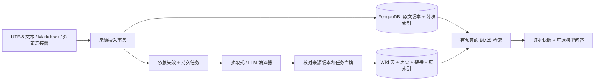

# FengquWiki：基于 FengquDB 的通用 LLM Wiki 底座

状态：0.1.0，可运行的单机后端底座。独立分支 `codex/llmwiki`，以 `32348fb` 为数据库基线，不包含原 `develop` 工作区未提交的 SDK 改动。

已解压部署包的用户可直接在解压目录运行 `python run-wiki.py --db wiki-data serve`。本文中的源码构建命令和相对仓库链接面向源码使用者；部署包同时附带验证记录。

## 目标与取舍

把资料编译成可持续维护的知识，而不是每次提问都重新整理。业务数据、原文版本、Wiki 页、倒排索引、依赖关系、任务、编译缓存和操作日志都保存在 FengquDB；运行时只有 Python 3.10+ 标准库与 FengquDB 原生共享库，无需 Redis、PostgreSQL、向量库或图数据库。HTTP 服务和编译 worker 在同一进程中运行。

这一版本适合作为个人知识库、团队内部 Wiki、产品知识底座和上层 Agent 的存储与编译层。它不包含网页前端。外部系统通过 JSON API 或 Python API 集成。

### 参考的公开方案

| 一手来源（2026-11-14 查阅） | 借鉴 | 本实现的选择 |
| --- | --- | --- |
| [Karpathy LLM Wiki](https://gist.github.com/karpathy/442a6bf555914893e9891c11519de94f) | 原始资料、编译知识、维护规则三层；知识在摄入时积累 | 不可变原文版本、可重建 Markdown、显式编译契约 |
| [DeepWiki-Open](https://github.com/AsyncFuncAI/deepwiki-open) | 将源材料整理成相互关联的 Wiki 页面 | 来源页与跨来源主题页，保留通用资料接口；仓库抓取留给连接器 |
| [LightRAG](https://github.com/HKUDS/LightRAG) | 增量维护、来源追踪和选择性删除 | 用数据库前缀键存依赖图与反向链接，按受影响页重编译 |

这些项目的性能描述不是 FengquWiki 的测试结果。本实现独立编写，没有复制它们的代码，也没有引入它们的框架依赖。仅有 Markdown 加向量检索并不能自动保证知识更新正确，因此这一版先落实版本和事务边界。

## 快速运行

在仓库根目录构建共享库：

```powershell
cmake -S . -B build/wiki -DFQDB_BUILD_TOOLS=OFF -DFQDB_BUILD_DIAGNOSTICS=OFF -DBUILD_TESTING=OFF
cmake --build build/wiki --config Release --target fengqudb
$env:FENGQUDB_LIBRARY = (Resolve-Path build/wiki/Release/fengqudb.dll).Path
python -m llmwiki --db build/wiki-data ingest examples/llmwiki/storage.md --uri knowledge:storage
python -m llmwiki --db build/wiki-data compile
python -m llmwiki --db build/wiki-data search "数据库 可靠写入"
python -m llmwiki --db build/wiki-data ask "数据库如何保证写入可靠性"
python -m llmwiki --db build/wiki-data serve
```

Linux：

```sh
cmake -S . -B build/wiki -DCMAKE_BUILD_TYPE=Release -DFQDB_BUILD_TOOLS=OFF -DFQDB_BUILD_DIAGNOSTICS=OFF -DBUILD_TESTING=OFF
cmake --build build/wiki --target fengqudb -j 4
export FENGQUDB_LIBRARY="$PWD/build/wiki/libfengqudb.so"
python3 -m llmwiki --db build/wiki-data ingest examples/llmwiki/storage.md --uri knowledge:storage
python3 -m llmwiki --db build/wiki-data compile
python3 -m llmwiki --db build/wiki-data serve
```

原生库路径可通过 `--library` 指定。默认服务地址为 `127.0.0.1:8098`。默认抽取式编译器将原文引用整理为来源页与主题页，不调用模型；默认问答返回带证据编号的原文片段。这是离线可用的保底方式，不应当作模型推理。

同一个资料始终使用同一个 `uri`。重复提交相同标题和正文会返回 `changed=false`，不重建索引、不新增编译任务。URI 只作为逻辑标识，服务不会主动访问 URL。

### 连接实际模型

检索实现可通过独立的 `index_provider` 替换，模型仍使用 `provider`。当前默认 Python 实现保留作为对照；公共原生索引的事务、过滤、版本、水位与迁移要求见 [Index Provider 对接契约](LLMWIKI_INDEX_PROVIDER.md)。原生适配器和水位能力尚未接入。

兼容 `/v1/chat/completions` 的本地服务器和远程模型均可接入：

```powershell
$env:WIKI_MODEL_URL = "http://127.0.0.1:8000/v1"
$env:WIKI_MODEL = "your-model-id"
# 远程服务如需凭据，用 WIKI_MODEL_KEY 环境变量提供。
python -m llmwiki --db build/wiki-data serve
```

模型接收来源正文，使用前应选择适合资料保密要求的端点。默认超时 60 秒、并发 2、输出上限 4096 token，单次输入 JSON 上限 100,000 字符，响应上限 2 MiB。超限会报错并进入任务重试，不静默丢弃一部分来源。大型资料可先按章节拆分。Python API 可传入其他实现了 `identity`、`compile(title, sources, links)`、`answer(question, evidence)` 的 provider。

模型或端点变更后，已发布页继续可读；用 `retry <page-id>` 显式重新编译。编译指纹包含页面规格、来源版本、模型配置和提示词版本。有效缓存可避免同一指纹重复调用模型；网络请求中断或进程在响应落库前崩溃仍可能造成重复模型费用，任务语义为至少执行一次。

### 创建跨资料主题

`ingest` 返回的 `id` 是 source id。主题由调用者指定来源集合，防止模型自行扩张摄入范围：

```powershell
python -m llmwiki --db build/wiki-data topic storage-guide "存储与可靠性" <source-id-1> <source-id-2>
python -m llmwiki --db build/wiki-data compile
python -m llmwiki --db build/wiki-data page storage-guide
```

`--link other-page-id` 可重复提供，建立 `[[other-page-id]]` 链接及反向链接。允许目标页稍后创建；`lint` 报告悬空链接。来源页使用保留前缀 `source-`，业务主题使用小写 ASCII slug。

Python 嵌入：

```python
from llmwiki import Wiki

with Wiki("wiki-data", library="/path/to/libfengqudb.so") as wiki:
    source = wiki.ingest("knowledge:storage", "数据库支持事务和可靠写入。", title="存储")
    wiki.define_page("storage-guide", "存储说明", [source["id"]])
    while wiki.run_once() is not None:
        pass
    print(wiki.ask("可靠写入"))
```

`compile` 只处理当前到期任务，不等待将来的退避重试；服务内 worker 会持续处理。失败任务可通过 `list job` 查看、通过 `retry <page-id>` 重新入队。

## 数据与一致性



所有键位于 `wiki/<namespace-hash>/` 下。`--namespace` 用于逻辑分区，**不是权限隔离机制**；持有数据库句柄的代码可读取其他分区。HTTP 实例只服务一个 namespace 和一个共享 token。一个数据库目录由一个服务进程持有；横向扩容通过独立分片或后续设计网关，不能让多个容器同时写同一卷。

| 键前缀 | 职责 |
| --- | --- |
| `source/<id>` | 稳定 URI 对应的当前来源指针及删除状态 |
| `raw/<id>/<revision>` | 不可变原始 UTF-8 正文、标题和 URI |
| `spec/<page>`、`dep/<source>/<page>` | 页面编译规格与来源反向依赖 |
| `page/<page>`、`history/<page>/<revision>`、`state/<page>` | 当前页、已发布历史与检索用轻量状态 |
| `doc/`、`body/`、`terms/` | 检索文档元信息、正文、删除所需词项集合 |
| `post/<term-hash>/<doc>`、`df/`、`search/stats` | 分项倒排记录与 BM25 统计 |
| `back/<target>/<page>` | Wiki 页反向链接 |
| `job/<page>`、`queue/<due-time>/<page>` | 任务状态与按时间排序的领取索引 |
| `artifact/<fingerprint>`、`event/<sequence>` | 编译结果缓存和追加事件记录 |

来源标识为 URI 的 SHA-256，修订标识包含 URI、标题和正文。更改标题同样会使相关 Wiki 页失效。来源摄入在一个事务内替换分块索引、写原文版本、移动当前指针、将依赖页标为 stale 并重新入队。

FengquWiki 的写事务使用 `force_reliable=True`，返回前等待可靠提交；数据库自身默认的 50 ms / 1 MiB 性能写入策略保持原配置。这样会增加写入延迟，但来源和任务在成功响应后不依赖一个待刷新的内存窗口。

任务使用持久租约和随机令牌，默认租期 180 秒。模型调用不持有数据库事务或写锁。发布时同时检查令牌、页面规格、来源修订；来源变化后的旧结果只会返回 `superseded`。租约过期后可重新领取，晚到的旧 worker 无法覆盖新结果。每次调度最多 3 次尝试，失败后指数退避，超过预算进入 failed；新资料变化与显式 retry 会开始新一轮。

`delete` 是逻辑删除：分块索引立即删除、依赖页立即 stale；worker 从剩余来源重建主题，最后一个来源删除时退役页面。查询排除 stale Wiki 页，因此旧页内容不会继续作为当前证据返回。**原文、页面历史、缓存和备份保留，不提供合规意义的物理擦除**。历史保留让引用可审计，也意味着磁盘用量持续增长；应安排备份和容量监控，不能把 compact 当作删除历史的保留策略。

## 检索与引用

英文和其他字母数字按 Unicode 单词分词；中日韩统一汉字区使用单字与双字组合，先做 NFKC 和 casefold。无词库、无分词模型、无 embedding 调用。每次摄入只重建这个来源的分块，发布只重建这个页面的索引；不会重建整个语料库。

查询默认最多 32 个独立词项、12,000 条倒排记录和 1,024 个候选，先处理低文档频率词。元信息和轻量 stale 状态原生批读，仅加载最终命中的正文，返回最多 4,000 字符的片段并标记 `text_truncated`。这是有界的近似 Top K；高频词或长查询触发 `truncated=true` 时，不保证全库最高得分结果。Python API 可调预算，HTTP 限制为固定预算。BM25 按文档长度归一化；问答对来源版本和范围完全相同的重复证据去重，不把同一原文的来源页和完整原文块当作两个独立来源。

编译页的每条来源引用包含 source id、不可变 revision、URI 和字符范围。字符偏移为 Python Unicode code point 下的 `[start, end)`，不是 UTF-8 字节偏移。模型必须返回结构化 JSON；来源标签与页链接需要和正文声明匹配，未知引用拒绝发布。引用标签的校验不等于语义事实校验：错误归因、遗漏及模型幻觉仍需要业务评估和人工审查。

问答只使用检索证据，默认 6 条、24,000 字符上下文，模型输出必须包含有效 `[E1]` 标签。返回 `evidence`、`citation_validated`、`stale`、`truncated`。`citation_validated=true` 只表示引用标签与提供的证据集合一致；不保证每一句话都得到证据支持。`stale=true` 表示模型响应期间来源或页面发生变化，调用方应重试或展示旧版本提示。`observed_database_version` 是取证时观察到的数据库版本，不冒充底层快照的精确版本号。

search/ask 同时返回 `ranking_kind`、`termination`、`index_coverage`、`total_hits` 与 `empty_result_confirmed`，分别描述排名、终止、覆盖和空结果证明。近似排名本身不等于预算截断；未确认无匹配项的空结果不会被描述成完整未命中。当前精确 `snapshot_version` / `applied_sequence` 为 null。

## HTTP API

服务暴露非回环地址时必须设置至少 24 个 ASCII 字符的 `WIKI_TOKEN`。除 `/health` 外所有接口都校验 `Authorization: Bearer <token>`。默认最多 24 个同时处理的连接、15 秒 socket 超时、2 MiB 请求体；不允许跨域 CORS。服务是面向受信客户端的轻量后端，对外部署应由 TLS 反向代理承担 TLS、速率限制和组织级身份认证。

| 方法 | 路径 | 请求 / 返回 |
| --- | --- | --- |
| GET | `/health` | 存活状态，无业务信息 |
| GET | `/v1/status` | 数据库、索引和任务统计 |
| POST | `/v1/sources` | `{uri, content, title?}`，返回来源与 changed |
| GET | `/v1/sources/<id>?revision=...` | 当前或历史原文 |
| DELETE | `/v1/sources/<id>` | 逻辑删除、依赖失效 |
| POST | `/v1/pages` | `{id, title, source_ids, links?}`，创建/更新规格并排队 |
| GET | `/v1/pages/<slug>?revision=...` | 当前或历史编译页；历史页标记 archived，反向链接只在当前页提供 |
| GET | `/v1/search?q=...&limit=10` | BM25 命中与预算信息，limit 最大 50 |
| POST | `/v1/ask` | `{question, limit?}`，带证据回答 |
| GET | `/v1/sources`、`/v1/pages`、`/v1/jobs`、`/v1/specs`、`/v1/events` | `limit` / `after` 游标分页，最多 200 条 |
| POST | `/v1/jobs/<slug>/retry` | JSON `{}`，重新入队 |
| GET | `/v1/lint` | 过期页、悬空链接、过期来源和缺失原文 |

单来源正文最多 256 KiB，单页最多 16 个来源，编译 Markdown 最多 1 MiB。HTTP 不接收任意本地文件路径、不执行模型返回的代码、不抓取模型给出的 URL。PDF、Office、网页抓取、Git 仓库同步和 OCR 由独立连接器转成 UTF-8 文本后摄入。

PowerShell 示例：

```powershell
$headers = @{ Authorization = "Bearer $env:WIKI_TOKEN" }
$body = @{ uri = "knowledge:example"; title = "示例"; content = "数据库支持可靠写入。" } | ConvertTo-Json
Invoke-RestMethod http://127.0.0.1:8098/v1/sources -Method Post -Headers $headers -ContentType 'application/json; charset=utf-8' -Body ([Text.Encoding]::UTF8.GetBytes($body))
```

## 交付、备份与维护

```powershell
python scripts/package-llmwiki.py --library build/wiki/Release/fengqudb.dll --output artifacts/FengquWiki-win-x64.zip
```

ZIP 包包含 Wiki 模块、当前公共 Python 绑定和指定平台的一个原生库。解压后运行 `python run-wiki.py --db <data-directory> serve`，无需 pip 安装。打包脚本不覆盖已有 ZIP。Linux 同理传入 `.so`，macOS 可传 `.dylib`；0.1 的实际验证平台以验证记录为准。

```powershell
python -m llmwiki --db build/wiki-data backup build/wiki-backup
python -m llmwiki --db build/wiki-data export build/wiki-export
python -m llmwiki --db build/wiki-data lint
python -m llmwiki --db build/wiki-data verify
python -m llmwiki --db build/wiki-data compact
```

backup 使用数据库的一致性备份 API，包含此目录中全部 namespace，目标必须不存在；备份目录可直接用 `--db` 重开。export 在一个快照上生成 `raw/`、`wiki/`、`index.md`、`manifest.json` 和 `log.jsonl`，也要求新目录；stale 页显著标注。export 是可阅读的快照，不是数据库恢复格式，数据库恢复使用 backup。

`serve` 默认启用数据库原生后台维护：每秒检查、沿用 32 MiB 最小文件/增长阈值和 30% 垃圾比例，单轮超时 1 秒、读写各不超过 512 MiB；不修改 50 ms / 1 MiB 写入策略。`status.maintenance` 返回运行状态、最近原生状态码与整理次数。持续出现 LIMIT/TIMEOUT 时需检查容量和负载，空闲时用 `compact` 手动整理；手动命令超时 30 秒。`--no-maintenance` 可关闭服务启动时的自动配置。嵌入 Python 默认不启用后台维护，可显式调用 `enable_maintenance()`。整理回收物理冗余，不删除仍保留的历史记录。

容器部署参考 [Dockerfile](../deploy/llmwiki/Dockerfile) 和 [compose.yaml](../deploy/llmwiki/compose.yaml)。Docker 中模型地址的 localhost 指向容器本身，应配置容器可达的模型端点。不要将同一数据卷挂给多个写服务。

验证与定向性能脚本：

```powershell
$env:FENGQUDB_LIBRARY = (Resolve-Path build/wiki/Release/fengqudb.dll).Path
python -m unittest discover -s tests -p test_llmwiki.py -v
python tools/llmwiki_benchmark.py --sources 200 --queries 100 --output build/wiki-benchmark.json
```

CI 独立构建原生库并在 Windows/Linux 运行上述相关测试，不修改数据库核心行为。测试覆盖事务回滚、更新/删除、引用、重启与强制退出恢复、租约与并发、模型协议和 HTTP 鉴权。未调用真实付费模型，模型质量与真实模型吞吐量不由这些测试证明。

## 扩展边界

已实现的是一个通用存储和编译契约，不是分布式知识平台。当前没有 ANN 向量索引、语义召回、自动发现全部实体/主题、自动判断事实冲突、细粒度 ACL、多人实时编辑或完整的来源保留策略。中文检索是词面召回，不能替代跨语言或同义语义检索。编译主题由调用方显式配置，没有把模型规划当作可靠事实。

后续应按真实工作负载决定是否引入 embedding：先增加批量 embedding provider 与版本缓存，再实现独立的可重建向量索引或候选重排；不能把 Python 全量向量扫描包装为高性能 ANN。超出单机容量时先按 namespace/业务域分片，评估热词倒排预算、存储增长与检索召回，再决定是否引入独立检索服务。升级数据库格式或 tokenizer 时必须迁移，当前 schema 不匹配会拒绝打开。
