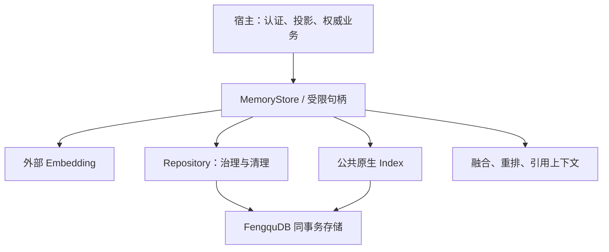

# 实际架构与协议

本轮交付为 Python 治理层加公共原生 Core/Index，没有新增 Rag C ABI。倒排、BM25、向量距离和 HNSW 由公共 Index 唯一实现。

## 模块

| 文件 | 职责 |
| --- | --- |
| models.py / types.py | 请求、类型、错误、取消与预算 |
| embedding.py | 契约、16 项批次、安全 L2/FP32、有界缓存 |
| repository.py | 目录、事实、编辑、审计、清理、恢复 |
| memory_index.py | 原生 mutation、强类型过滤、完成性和预算 |
| memory.py | 账户句柄、兼容 API、召回与最终复核 |
| context.py | 引用、来源排除、业务谓词、字符/token 预算 |
| native.py / sources.py | 独立的预计算向量 source/chunk API |
| integrations/wordgame_rag | Provider 注入与 AppError 适配 |

## 存储和隔离

每账户一个 root/SHA256(account_id)/memory Store，默认最多缓存 8 个账户句柄；忙碌句柄不淘汰。1000 owner 共用账户 Store。支持单进程 SDK 多线程；多进程通过宿主服务访问，不直接共享可写目录。

保留键前缀 fqrag-memory-v1/，原生 Index 空间 fengqu-rag-memory-v1。元数据校验 schema、账户、时钟和完整模型契约；非空库缺元数据、契约变更或旧 zvec 目录拒绝打开。

| 键 | 内容 |
| --- | --- |
| R/id、Q/id | 权威记录、规范 FP32 向量 |
| N/namespace | scope/owner/timeline、generation、epoch、active、任务 |
| D、S、B、T | 浏览、来源、事实、事实知情时间的有序目录 |
| E、F | 精确 payload 去重、事实 head |
| L、C | 谱系成员、全谱系单调 revision |
| A、V | 有序审计、逐记录审计反向目录 |
| J | 可恢复清理任务与可靠进度 |

Index partition 是 [scope, owner, timeline, generation] 的规范摘要，原字段仍由谓词校验。空 owner 仅为公共资料；include_public 仅并入同账户/scope/timeline 公共 partition。受限句柄固定账户与 namespace，get/history/edit/delete 同样受限。宿主负责认证、铸造句柄；恶意代码直接读文件不属于此权限边界。

## 写入和事实

prepare 捕获 epoch/generation、编辑版本和去重结果；必要时独立可靠建立 namespace 元数据，不提前发布业务记录。模型计算在写锁外，只处理缺失文本；标题编辑复用向量。commit 再核对 epoch、active、任务和版本，同事务发布记录、向量、审计、目录及 Index；失败取消整批，不静默拆分部分成功。

新事实 known_at 严格递增，旧版 expiry 取原值与新 known_at 的较小值。可见区间为 known_at <= as_of < expires_at，历史不重开。纠错保留 ID、归属、来源、fact_key、事实区间并保存旧快照。全谱系 revision 单调分配，projection_version 独立用于原生 CAS。

默认写批次 1024、总正文 4MiB；HTTP 16 项限制由宿主保留。原生预算仍可能拒绝整批。账户 Store cache/delta 各 16MiB、模型缓存 4MiB，是预算而非进程 RSS 上限。权威提交强制 reliable，未改全局写策略。

## 清理和恢复

先可靠保存 J 任务与 epoch 屏障，再分批删除。每步最多 128 条记录，每条一次最多删除 64 个审计键，长历史跨步继续。get/list/history/search 隐藏屏障命中的内容，新写入拒绝未完成清理的 namespace。中断保留进度，账户重开自动恢复；已删批次不恢复。

delete(id) 删除整谱系；delete_matching 的来源限制只删除该来源，保留其他来源及其关闭区间。全 namespace 清理完成提升 generation，新内容进入新 partition；retire 还持久禁止新写入。

COMMIT_UNKNOWN/RECOVERY_REQUIRED 封锁账户后续访问，须 close/reopen；未知结果不描述为回滚。逻辑清理不安全擦除旧 WAL、快照、原生墓碑或外部备份，压缩和备份保留由宿主管理。

## 检索和输出

默认 dense exact；授权、来源、时间、清理过滤先进入原生 Query。lexical 使用 statistics_policy=1，BM25 的 N/avgdl/df 只含 where 可见文档，未来/隐藏内容不改变统计。纯 lexical 无 cosine 阈值时不调用查询模型。

owner/public 与各检索流同快照，并合计扣减 posting/candidate/scan 预算。hybrid 对有限候选做 RRF；lexical-only 候选的 cosine 由原生 exact 计算。跨 partition 用排名融合，不直接相加不同语料的原始 BM25。非 dense 显式标注 bounded_candidate_fusion。

候选必须 finished/complete、快照一致、工作统计合法、证据确定。投影逐项匹配权威 ID、版本、hash、正文、locator、元数据、模型空间。重排只能排列已授权候选，分数不冒充 cosine。上下文带 ID/revision/hash 引用；token 预算必须有宿主真实计数器。

回调后、发布前，在账户门控下打开当前快照复核所有输出版本和屏障；变化报 RagStaleRead。已返回内容不能撤回。超限、取消、未知或部分结果不伪装成功空列表。MemoryStore 本版未接入 ANN，精确模式规模边界须实测。
